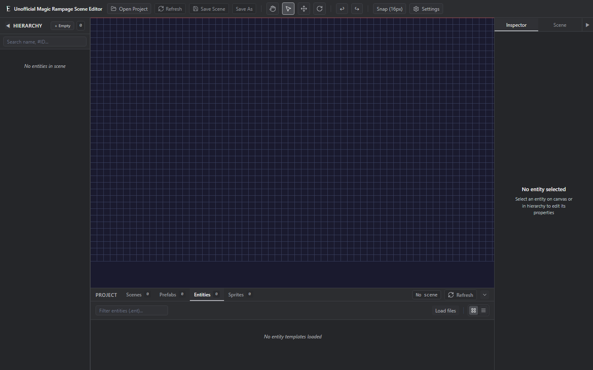

# Unofficial Magic Rampage Scene Editor

An experimental, community-built scene editor for Ethanon projects used by Magic Rampage. It is a modern alternative to the scene editor in the open-source [Ethanon engine](https://github.com/asantee/ethanon), developed with reference to its editor concepts and scene format. This is an independent project, not an official Ethanon release.

The editor aims to make scene creation easier and faster through a more approachable interface and tools such as reusable prefabs. It runs as a web application in supported browsers and also has a Tauri desktop wrapper. The current desktop release target is Windows x64; see [Status](#status) for the platform and compatibility limits.



> [!WARNING]
> This project is experimental. Back up your project or keep it under version control before saving scene files.

> [!IMPORTANT]
> This is an unofficial community project. It is not affiliated with, endorsed by, or supported by Magic Rampage or its developers. Game names, trademarks, and assets belong to their respective owners.

The repository and release packages do **not** include game assets. You must provide project files that you are legally allowed to use.

## Status

Version `0.1.0` is intended as an experimental Windows x64 desktop release. The web editor can run on platforms with a Chromium-based browser that supports the File System Access API; desktop packages for other platforms are not currently provided. File-format support is based on the parser, serializer, and synthetic compatibility tests in this repository; it is not a guarantee that every game or Ethanon format variant is supported.

## Features

- Open an Ethanon project folder and browse scenes, entity templates, sprites, and prefabs.
- Read and write `.esc` scene files and `.prf` prefab files.
- Render and navigate scenes through a PixiJS viewport.
- Select, move, rotate, duplicate, copy, paste, and delete entities.
- Edit entity properties, scene properties, hierarchy, and local transforms.
- Use grid display and transform snapping.
- Undo and redo entity edits.
- Export reusable prefabs and place copies of their entities into scenes; optionally save scenes without editor metadata.
- Run as a browser application or a Tauri desktop application.

## Requirements

### Web development

- Node.js 24.x
- pnpm 10.33.2
- A Chromium-based browser with the File System Access API, such as current Chrome or Edge, for opening project folders

### Windows desktop development

- The web-development requirements above
- Rust stable with the MSVC toolchain
- Microsoft C++ Build Tools and WebView2 as required by [Tauri 2 prerequisites](https://v2.tauri.app/start/prerequisites/)

## Quick start

From a local checkout of this repository, run:

```powershell
corepack enable
pnpm install --frozen-lockfile
pnpm dev
```

To run the desktop application:

```powershell
pnpm tauri dev
```

See [Getting started](docs/getting-started.md) for the project layout and basic editor workflow.

## Project folder layout

```text
my-project/
├── scenes/       # Required: .esc scene files
├── entities/     # Required: entity definitions, images, and texture atlases
└── prefabs/      # Optional: .prf prefab files
```

The editor asks for read/write access to the selected folder. It does not create the required `scenes` or `entities` directories for you. See [Project structure](docs/project-structure.md) for details.

## Common shortcuts

| Shortcut | Action |
| --- | --- |
| `Q` | Grab/pan tool |
| `S` | Select tool |
| `W` | Move tool |
| `E` | Rotate tool |
| `G` | Toggle the grid |
| `Ctrl+Z` | Undo |
| `Ctrl+Y` | Redo |
| `Ctrl+D` | Duplicate selection |
| `Ctrl+C` / `Ctrl+V` | Copy/paste selection |
| `Delete` or `Backspace` | Delete selection |

Editor shortcuts are ignored while focus is in a text input or textarea. See [Getting started](docs/getting-started.md#edit-the-scene) for selection gestures and other editing steps.

## Development

```powershell
pnpm test
pnpm lint
pnpm build
```

Build the unsigned Windows x64 installer with:

```powershell
pnpm tauri build --bundles nsis --target x86_64-pc-windows-msvc
```

Unsigned development releases may trigger Microsoft Defender SmartScreen. Verify the release checksum before running an installer.

For an overview of the codebase, see [Architecture](docs/architecture.md).

## Known limitations

- Desktop installers are not code-signed.
- The browser build requires a browser that supports directory picking with read/write access.
- Editor shortcuts may still run while a dropdown is focused; input handling for these controls remains unresolved.
- Some scene, entity, material, particle, or encoding variants may not yet be supported.
- Saving is not guaranteed to be lossless for unknown format variants. Work from a backup.
- Automatic updates are not configured.

## Bug reports and contributions

Bug reports are welcome. Include reproduction steps, expected and actual behavior, platform information, and a minimal synthetic fixture when a file is required.

Do not attach files or assets extracted from the game. Feature requests and pull requests are not being accepted during the experimental phase. See [Contributing](CONTRIBUTING.md) and [Security](SECURITY.md).

## Third-party licenses

Third-party software and adapted portions remain under their respective licenses; see [Third-party notices](THIRD_PARTY_NOTICES.md) and the [license-text appendix](THIRD_PARTY_LICENSES.md).

Before a release, run `pnpm notices:check`. After changing a dependency, inspect its license and copyright notices, then run `pnpm notices:update` and review the generated inventory and appendix. The release workflow runs the read-only check after installing the locked dependencies.
